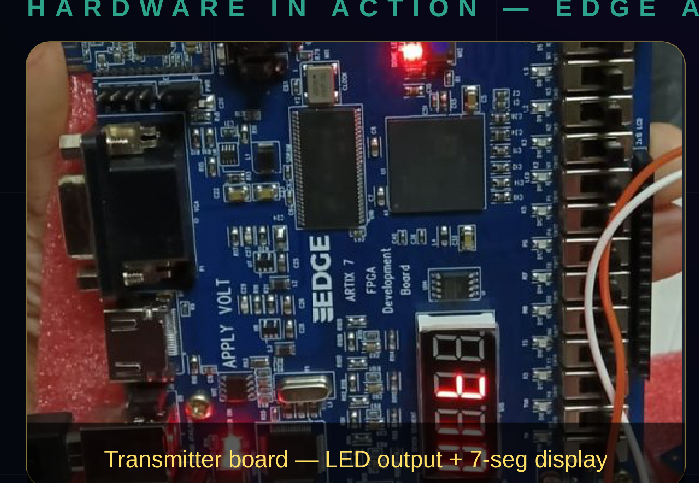
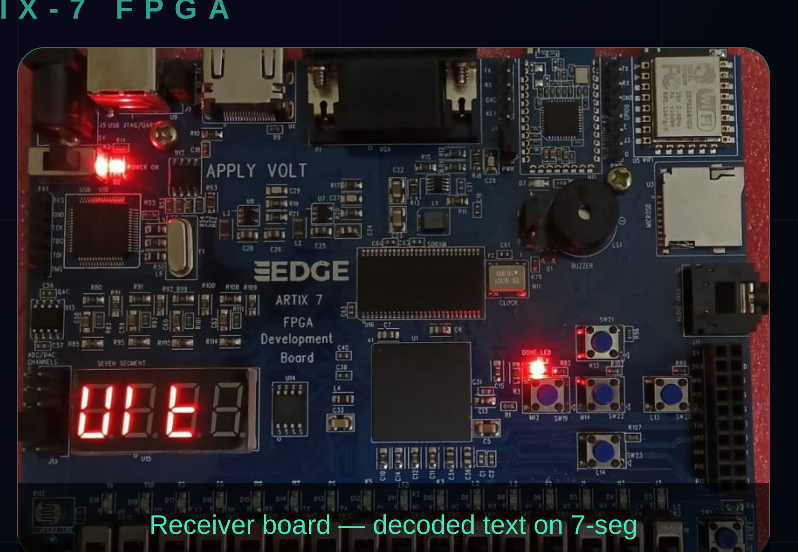
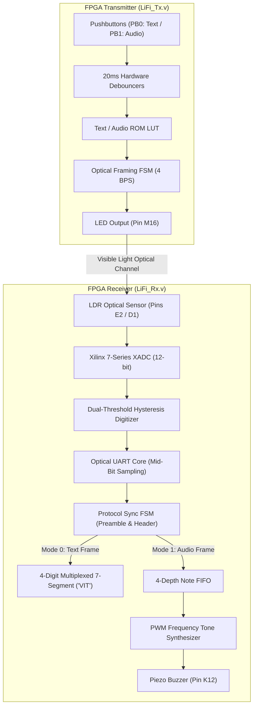

# Optical Wireless Communication (Li-Fi) Transceiver on Artix-7 FPGA

[-red.svg)](https://www.xilinx.com)

[-purple.svg)]()

A complete, bare-metal **Optical Wireless Communication (OWC / Li-Fi)** digital transceiver system implemented in synthesizable **Verilog HDL** on the **AMD Xilinx Edge Artix-7 FPGA (XC7A35T)**.

The system transmits digital data wirelessly over free-space visible light using high-brightness LEDs and an optical photodetector (LDR). The receiver leverages the on-chip **Xilinx 7-Series XADC** for analog digitization with hysteresis thresholding, an asynchronous optical protocol decoder, and dual output engines: a 4-digit 7-segment alphanumeric display and a real-time musical frequency tone synthesizer driving a piezo buzzer.

---

## 1. Physical Hardware Demonstration (Edge Artix-7 FPGA)

<table align="center">
  <tr>
    <td align="center" width="50%">
        
      <b>TRANSMITTER BOARD (EDGE ARTIX-7)</b> 
      <b>Optical Source:</b> High-Brightness White LED (Pin <code>M16</code>) <b>Control:</b> Pushbutton <code>PB0</code> ("VIT") / <code>PB1</code> (Sargam Notes)
    </td>
    <td align="center" width="50%">
        
      <b>RECEIVER BOARD (EDGE ARTIX-7)</b> 
      <b>Optical Sensing:</b> 7-Series XADC (Pins <code>E2/D1</code>) <b>Output:</b> 7-Segment Display <code>VIt </code> + Piezo Buzzer <code>K12</code>
    </td>
  </tr>
</table>

  <em>Figure 1: Live physical hardware verification across two Edge Artix-7 FPGA development boards. (Left) Transmitter streaming modulated visible light pulses. (Right) Receiver digitizing optical transitions and displaying decoded ASCII text ("VIt") on the 7-segment display.</em>

---

## 2. System Architecture Overview

---

## 3. Key Engineering Innovations & Features

### A. Optical Smearing Mitigation (4 BPS Calibrated Timing)
Standard photoresistors (LDRs) suffer from slow chemical response rise and fall times ($\approx 10\text{--}50\text{ ms}$). To achieve $100\%$ zero-bit-error optical transmission without expensive high-speed photodiode amplification circuits, the serial transmission tick was calibrated to **4 BPS** ($12,500,000\text{ clock cycles at 50 MHz}$).

### B. On-Chip Analog Mixed-Signal Digitization (Xilinx XADC)
Instead of relying on external comparator hardware, the receiver utilizes the dedicated **7-Series XADC** auxiliary analog channel 15 (`vauxp15`, `vauxn15`):
* **Resolution:** 12-bit analog-to-digital conversion.
* **Hysteresis Noise Immunity:** A digital Schmitt-trigger filter ensures stable state transitions:
  $$\text{Bit} = \begin{cases} 1 & \text{if } V_{ADC} > 1000 \\ 0 & \text{if } V_{ADC} < 800 \\ \text{Retain State} & \text{otherwise} \end{cases}$$

### C. Robust Packet Synchronization Framing
Every transmitted optical burst is encapsulated within a robust packet frame:
1. **Preamble:** 3 consecutive synchronization bytes (`0x55`, `0x55`, `0x55`) to prime the receiver AGC and align UART edge detectors.
2. **Mode Header:**
   * `0xAA`: Text Transmission Mode.
   * `0xBB`: Audio Music Transmission Mode.
3. **Data Payload:** 3 text ASCII bytes or 8 sequential musical note tokens.

---

## 4. Operational Modes

### Mode 0: Alphanumeric Text Transmission
* **Trigger:** Pressing pushbutton `PB0` (`K13`).
* **Payload:** Text string `"VIT"` (Vidyalankar Institute of Technology).
* **Receiver Action:** Characters are decoded, shifted into the display buffer, and rendered on the 4-digit time-multiplexed 7-segment display (`V I t  `).

### Mode 1: Real-Time Audio / Musical Tone Synthesizer
* **Trigger:** Pressing pushbutton `PB1` (`L14`).
* **Payload:** 8-note musical scale ("Sargam" — Sa, Re, Ga, Ma, Pa, Dha, Ni, Sa).
* **Receiver Action:** Pushed into an internal FIFO and processed by a dedicated hardware frequency synthesizer generating exact square-wave pitch periods:

| Note Token | Swara / Note | Target Frequency | Hardware Half-Period Counter (`50 MHz`) |
| :---: | :---: | :---: | :---: |
| `1` | **Sa** | $261.63\text{ Hz}$ | `95,785` clock cycles |
| `2` | **Re** | $293.66\text{ Hz}$ | `85,034` clock cycles |
| `3` | **Ga** | $329.63\text{ Hz}$ | `75,758` clock cycles |
| `4` | **Ma** | $349.23\text{ Hz}$ | `71,633` clock cycles |
| `5` | **Pa** | $392.00\text{ Hz}$ | `63,776` clock cycles |
| `6` | **Dha** | $440.00\text{ Hz}$ | `56,818` clock cycles |
| `7` | **Ni** | $493.88\text{ Hz}$ | `50,607` clock cycles |
| `8` | **Sa' (High)** | $523.25\text{ Hz}$ | `47,801` clock cycles |

---

## 5. Hardware Peripheral Pinout Specifications

### Transmitter Board (`Lifi Transmitter Constraint`)
| Port Signal | FPGA Pin | I/O Standard | Description |
| :--- | :---: | :---: | :--- |
| `clk` | **`N11`** | LVCMOS33 | 50.00 MHz System Clock |
| `pb0` | **`K13`** | LVCMOS33 | Pushbutton 0: Trigger Text Frame ("VIT") |
| `pb1` | **`L14`** | LVCMOS33 | Pushbutton 1: Trigger Audio Frame (Sargam scale) |
| `tx_led` | **`M16`** | LVCMOS33 | Optical Transmit Output (Drives High-Brightness LED) |
| `led_status` | **`J3`** | LVCMOS33 | Onboard diagnostic LED mirroring optical pulse |

### Receiver Board (`Receiver constraint`)
| Port Signal | FPGA Pin | I/O Standard | Description |
| :--- | :---: | :---: | :--- |
| `clk` | **`N11`** | LVCMOS33 | 50.00 MHz System Clock |
| `vauxp15` | **`E2`** | LVCMOS33 | XADC Auxiliary Analog Channel 15 (Positive LDR input) |
| `vauxn15` | **`D1`** | LVCMOS33 | XADC Auxiliary Analog Channel 15 (Negative LDR input) |
| `buzzer` | **`K12`** | LVCMOS33 | Piezo buzzer PWM audio output |
| `led_mode` | **`J3`** | LVCMOS33 | Mode Indicator (Low = Text, High = Audio) |
| `led_dbg[0]` | **`H3`** | LVCMOS33 | Digitized Optical LDR State |
| `led_dbg[1]` | **`J1`** | LVCMOS33 | Frame Sync Acquired Flag |
| `led_dbg[2]` | **`K1`** | LVCMOS33 | Audio Engine Active Indicator |
| `led_dbg[3]` | **`L3`** | LVCMOS33 | Packet Received Activity Toggle |
| `seg_an[3:0]` | `G4, G5, E1, F2` | LVCMOS33 | 4-Digit Display Active-High Anodes |
| `seg_data[7:0]` | `G2, G1, H5, H4, J5, J4, H2, H1` | LVCMOS33 | 7-Segment Display Cathode Lines |

---

## 6. Synthesis & Implementation in Vivado

### Building the Transmitter
1. Create a Vivado project targeting `xc7a35tftg256-1`.
2. Add `Lifi_Tx.v` as design source.
3. Add `Lifi Transmitter Constraint` as constraint file.
4. Run synthesis, implementation, and program the transmitter Edge Artix-7 board.

### Building the Receiver
1. Create a second Vivado project targeting `xc7a35tftg256-1`.
2. Add `LiFi_Rx.v` as design source.
3. Add `Receiver constraint` as constraint file.
4. Run synthesis, implementation, and program the receiver Edge Artix-7 board.

---

## Author & Academic Affiliation

* **Author:** Pooja Pramod Nagvekar
* **Department:** Electronics & Telecommunication Engineering (EXTC)
* **Institution:** Vidyalankar Institute of Technology (VIT Mumbai), Accredited A+ by NAAC
* **License:** This project is open-source under the [MIT License](LICENSE).
